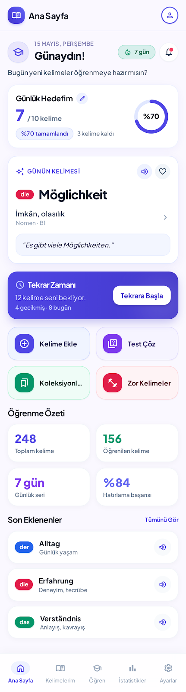

<div align="center">

# 📖 Kelime Defterim

**Almancayı kelime kelime değil, dilbilgisiyle birlikte öğren.**
Kişisel sözlüğünü kur, aralıklı tekrar ile pekiştir, ana ekran widget'ları ile her an pratik yap — hepsi cihazında, internet bağlantısı olmadan.

[](https://github.com/mehmet-karataslar/Kelime-Defterim/releases/latest)
[](https://capacitorjs.com)
[](https://react.dev)
[](https://www.typescriptlang.org)
[](https://vitejs.dev)
[](#-android-ana-ekran-widget%C4%B1)
[](#-veri-yedekleme-ve-gizlilik)
[](#-çoklu-dil)

`tek kullanıcı · sunucu yok · hesap yok · verin cihazda kalır · github üzerinden güncellenir`

[📥 En Son Sürümü İndir (APK v1.0.2)](https://github.com/mehmet-karataslar/Kelime-Defterim/releases/latest)

</div>

---

## İçindekiler

- [Nedir?](#-nedir)
- [Ekranlar](#-ekranlar)
- [Almanca dil modeli](#-almanca-dil-modeli)
- [Kelime yönetimi](#-kelime-yönetimi)
- [Öğrenme modları](#-öğrenme-modları)
- [Tekrar motoru (Spaced Repetition)](#-tekrar-motoru-spaced-repetition)
- [Android ana ekran widget'ı](#-android-ana-ekran-widgetı)
- [Uygulama içi APK güncelleme](#-uygulama-içi-apk-güncelleme)
- [İstatistik ve hedefler](#-istatistik-ve-hedefler)
- [Bildirimler](#-bildirimler)
- [Tema ve görünüm](#-tema-ve-görünüm)
- [Çoklu dil](#-çoklu-dil)
- [Veri, yedekleme ve gizlilik](#-veri-yedekleme-ve-gizlilik)
- [Mimari](#-mimari)
- [Teknoloji](#-teknoloji)
- [Kurulum ve Android derlemesi](#-kurulum-ve-android-derlemesi)
- [Durum: ne tamamlandı, ne eksik](#-durum-ne-tamamlandı-ne-eksik)
- [Yol haritası](#-yol-haritası)

---

## ✨ Nedir?

Kelime Defterim, Almanca öğrenen biri için tasarlanmış kişisel bir Android kelime ve dilbilgisi platformudur. Basit bir "kelime → çeviri" listesinden farkı, Almancanın gerçek dilbilgisini taşıması: isimler artikel ve çoğul biçimiyle, fiiller çekim ve yardımcı fiiliyle, sıfatlar komparativ/superlativ dereceleriyle, edatlar hangi hâli (Kasus) gerektirdiğiyle kaydedilir.

Uygulama tek kullanıcı içindir: kayıt ekranı, bulut hesabı veya sunucu sorgusu yoktur. Tüm veri cihazda saklanır, hiçbir içerik üçüncü taraf bir servise gönderilmez. Seslendirme cihazın kendi ses motorundan gelir. İnternet bağlantısı yalnızca isteğe bağlı GitHub güncellemeleri ve font indirmeleri için kullanılır.

| Özellik | Açıklama |
|---|---|
| 🗂 **36 örnek kelime + 5 koleksiyon** | 4 adımlı onboarding'de tek dokunuşla yüklenir, tek dokunuşla temizlenir |
| 🧠 **8 öğrenme modu** + aralıklı tekrar | Kart, artikel, anlam, yazma, dinleme, eşleştirme, cümle, zor kelimeler |
| 🇩🇪 **11 kelime türü** için dinamik form | Nomen, Verb, Adjektiv, Präposition ve diğerleri |
| 📲 **Özelleştirilebilir Ana Ekran Widget'ı** | Kart veya liste görünümü, hazır temalar, saydamlık ve canlı önizleme |
| 🔄 **Uygulama içi GitHub Güncelleyici** | Depodaki yeni sürümleri doğrudan uygulama içinden denetler, indirir ve kurar |
| 📊 **Gerçek veriden grafikler** | Isı haritası, haftalık çubuklar, durum halkası, CEFR dağılımı |
| 🎨 **8 renk paleti**, açık/koyu tema | Kişiselleştirilebilir artikel renkleri ve metin boyutları |
| 🌍 **TR / DE / EN arayüz** | Arayüz dili ile kelime anlam dili birbirinden bağımsız çalışır |

---

## 📱 Ekranlar

Aşağıdaki görseller projenin tasarım referansıdır (Stitch çıktıları, `TasarimGorselleri/` altında). Uygulama bu tasarımlardan Material 3 ilkeleriyle üretilmiştir.

| Ana Sayfa | Kelimelerim |
|---|---|
|  |  |
| **Öğren & Tekrar Et** | **İstatistikler** |
|  |  |

Ekran akışı: altta 5 sekme (**Ana Sayfa · Kelimelerim · Öğren · İstatistikler · Ayarlar**), üzerinde yığınlı (stack) alt sayfalar: kelime detayı, kelime editörü, koleksiyon detayı, oturum kurulumu ve çalışma oturumu. Android çentikli ve kameralı ekranları için **Safe Area** boşluğu otomatik korunur; Android geri tuşu `popstate` üzerinden yığını geri sarar.

---

## 🇩🇪 Almanca dil modeli

Kelime kaydı düz bir çeviri satırı değil, zengin ilişkisel bir yapıdır. Bir kelimenin birden çok anlamı (Sense), her anlamın kendi bağlamı bulunabilir:

```ts
// die Bank → "oturak" ve "finans kurumu" aynı kayıtta, ayrı anlamlar olarak
{
  german: 'Bank', article: 'die', type: 'noun', level: 'A2',
  senses: [
    { tr: 'Bank, oturak', en: 'bench' },
    { tr: 'Banka (finans kurumu)', en: 'bank (financial institution)', context: 'Finans' },
  ],
  noun: { plural: 'die Bänke' },
  examples: [
    { de: 'Wir sitzen auf der Bank.', tr: 'Bankta oturuyoruz.' },
    { de: 'Ich gehe zur Bank.',      tr: 'Bankaya gidiyorum.' },
  ],
}
```

Kelime türü seçildiğinde editörde **o türe özgü dinamik form** açılır ([`src/core/types.ts`](src/core/types.ts)):

| Tür | Alanlar |
|---|---|
| **Nomen** | artikel (`der/die/das`), çoğul, Genitiv Singular, `nur Plural`, `ohne Plural`, N-Deklination |
| **Verb** | 3. tekil şimdiki zaman, Präteritum, Partizip II, yardımcı fiil (`haben`/`sein`), düzensiz, ayrılabilir, dönüşlü, modal, gerektirdiği edat + Kasus |
| **Adjektiv** | Komparativ, Superlativ |
| **Präposition** | gerektirdiği hâller (Akk/Dat/Gen), Wechselpräposition işareti |
| **Diğer** | Adverb, Pronomen, Konjunktion, Numerale, Interjektion, Redewendung/Feste Wendung, Sonstige |

Yazım kuralları: metinler Unicode **NFC** olarak normalize edilir; arama `ä→a`, `ö→o`, `ü→u`, `ß→ss` katlamasıyla `Mädchen`, `maedchen` ve `madchen` aramalarının hepsinde doğru sonuç verir.

---

## 🗂 Kelime yönetimi

- 🔍 **Arama**: kelime, her iki dildeki anlamlar (TR/EN), etiketler ve örnek cümleler içinde arama.
- 🎯 **Filtreler**: favori, CEFR seviyesi (A1-C2), kelime türü, artikel, öğrenme durumu, koleksiyon.
- ↕️ **Sıralama**: en yeni, en eski, alfabetik, en çok tekrar, en çok hata, vakti gelenler.
- ✅ **Çoklu seçim**: toplu silme, koleksiyona atama, favorileme, tekrar listesine alma.
- ↩️ **Geri alma**: silme sonrası `undoBuffer` üzerinden kelime + tekrar geçmişi + koleksiyon bağları tek dokunuşla geri yüklenir.
- ✏️ **İki ekleme modu**: *Hızlı ekleme* (yalnızca kelime, tür ve anlam) ve *Detaylı ekleme* (10 bölüm, çekimler, örnekler).

---

## 🎓 Öğrenme modları

| Mod | Ne yapılır | Uygun kelime havuzu |
|---|---|---|
| `flashcard` | Kartı çevir, öz-değerlendir: *Tekrar · Zorlandım · Bildim · Çok kolay* | Tümü |
| `article` | Kelime gösterilir, `der / die / das` seçilir | Artikelli isimler (`nur Plural` hariç) |
| `meaning` | Kelimeye 4 anlamlı çoktan seçmeli soru | En az bir TR anlamı olanlar |
| `writing` | Anlamdan Almanca kelimeyi yaz, yazım denetimi | Tümü |
| `listening` | Kelime seslendirilir, sen yazarsın/seçersin | Tümü |
| `matching` | Kelime–anlam eşleştirme | Tümü |
| `sentence` | Örnek cümledeki boşluğu/çekimi tamamla | Örneğinde kelimesi geçenler |
| `hard` | Sürekli unutulan kelimeler üzerinde ekstra çalışma | `isStruggling()` eşleşenler |

🔊 **Telaffuz**: native tarafta `@capacitor-community/text-to-speech` ile `de-DE` sesi, web'de `SpeechSynthesis` yedeği kullanılır. Ses hızı ayarlardan değiştirilebilir.

---

## 🧠 Tekrar motoru (Spaced Repetition)

Algoritma bileşenlerden bağımsız saf bir servistir: [`src/core/srs.ts`](src/core/srs.ts). SM-2 ailesinden, 4 yanıta göre çalışan bir zamanlayıcı:

| Yanıt | Etki |
|---|---|
| **Tekrar (0)** | `ease −0.2`, aralık sıfırlanır, `lapses +1`, 10 dakika sonra tekrar, durum → `relearning` |
| **Zorlandım (1)** | `ease −0.15`, ilk seans yarım gün, sonra `aralık × 1.2` |
| **Bildim (2)** | 1. seans → 1 gün, 2. seans → 3 gün, sonrası `aralık × ease` |
| **Çok kolay (3)** | `ease + 0.15`, aralık `× ease × 1.3` |

Kelime durumları: **Yeni · Öğreniliyor · Tekrar ediliyor · Yeniden öğreniliyor · Öğrenilmiş**. Zorlanma tespiti `lapses ≥ 3` veya son 4+ denemede doğruluk <%50 üzerinden yapılır. Tekrar zamanları cihazda kalıcı olarak saklanır.

---

## 📲 Android ana ekran widget'ı

Android ana ekranınızda her an Almanca kelimeleri görmek için gelişmiş bir yerel widget (`KelimeWidgetProvider.java`) entegre edilmiştir:

- 🗂 **İki Farklı Görünüm Düzeni:**
  - **Günün Kelimesi (Kart Modu):** Büyük Almanca kelime, renkli artikel rozeti, Türkçe karşılık ve örnek cümle.
  - **Kelime Listesi (Çoklu Mod):** Ana ekranda alt alta 3, 4 veya 5 kelimeyi aynı anda gösteren zengin liste.
- 🎨 **Hazır Hızlı Temalar:** Açık Kart (beyaz), Koyu Gece (lacivert), Şeffaf Cam (duvar kağıdını gösteren yarı saydam efekt), Mor Renk.
- 🎛 **Gelişmiş Ayarlar:**
  - Arka plan şeffaflığı (%20 - %100)
  - Metin boyutu ölçeği (%85 - %180)
  - Kenarlık kalınlığı ve köşe yuvarlaklığı
  - Otomatik döngü sıklığı (30 dk - 24 saat)
  - Kelime kaynağı (Tüm kelimeler, favoriler, günün kelimeleri veya belirli bir koleksiyon)
- ⚡ **Android Binder IPC Güvenliği:** Yüksek çözünürlüklü ekranlarda bellek sınırlarını aşmayacak şekilde optimize edilmiş, anında yüklenen `initialLayout` şablonu ile sıfır gecikmeli render.

---

## 🔄 Uygulama içi APK güncelleme

Uygulamanın GitHub Releases deposundaki güncellemelerini takip eden yerel bir güncelleme modülü (`UpdaterPlugin.java` + `src/features/updater/`) içerir:

- 🔍 **Depo Kontrolü:** GitHub Releases API üzerinden en yeni sürümü denetler.
- 🛡 **SHA-256 Doğrulama:** İndirilen APK dosyasının bütünlüğü ve güvenliği SHA-256 özetiyle doğrulanır.
- 📦 **Doğrudan Kurulum:** Android `PackageInstaller` oturumu ile uygulamayı terk etmeden güncelleme paketini başlatır.
- ⏱ **Kanal Seçimi:** Kararlı (Stable) veya Önizleme (Beta) kanalları desteklenir.

---

## 📊 İstatistik ve hedefler

Rakamlar mock değildir, gerçek kullanıcı verileri üzerinden hesaplanır:

- **Bugün**: günlük hedef çemberi (tamamlanan / `dailyGoal`), vakti gelen tekrar sayısı.
- **Seri**: pazartesi başlangıçlı haftalık çubuklar + 4 haftalık **ısı haritası**.
- **Dağılım**: durum halkası ve CEFR (A1-C2) seviye kırılımları.
- **Başarı**: genel hatırlama oranı, artikel doğruluğu, en çok hata yapılan kelimeler.

---

## 🔔 Bildirimler

Ayarlar → Bildirimler bölümünden açılır.
- **Aralıklar**: 1, 5, 10, 15, 30, 45, 60 dakika veya 2, 3, 6 saatte bir.
- **Sabit saatler**: Gün içinde 6 adede kadar özel hatırlatma zamanı.
- **Sessiz saatler**: Uyku saatlerinde bildirimleri engelleme.
- Android `@capacitor/local-notifications` ile sistem planlayıcısına kaydedilir.

---

## 🎨 Tema ve görünüm

- **Tema**: Açık / Koyu / Sistem.
- **8 renk paleti**: Ultramarine · Adaçayı yeşili · Sıcak turuncu · Okyanus mavisi · Lavanta · Toprak · Bordo · Minimal gri.
- **Artikel renkleri**: `der`, `die`, `das` renkleri kullanıcı tarafından ayrı ayrı özelleştirilebilir.
- **Özel İkon**: Özel tasarlanmış mor-beyaz modern adaptive Android launcher ikonu.
- **Güvenli Üst Alan (Safe Area)**: Durum çubuğu ve kamera çentiği ile çakışmayı önleyen otomatik CSS ortam değişkeni desteği.

---

## 🌍 Çoklu dil

Arayüz **TR / DE / EN**; kelime anlamları **TR / EN** tutulabilir. İki ayar birbirinden tamamen bağımsızdır:

```
Arayüz: Türkçe  ·  Öğrenilen dil: Almanca  ·  Anlam: Türkçe
Arayüz: Almanca ·  Öğrenilen dil: Almanca  ·  Anlam: İngilizce
```

---

## 💾 Veri, yedekleme ve gizlilik

- **Depolama**: Zustand + `persist` middleware ile `localStorage` üzerinde tek kalıcı kayıtta tutulur.
- **Tam Yedek (JSON)**: Kelimeler, anlamlar, örnekler, koleksiyonlar, tekrar geçmişi ve ayarlar dışa aktarılabilir ve geri yüklenebilir.
- **CSV Dışa Aktarma**: Excel uyumlu UTF-8 BOM ile kelime listesi dışa aktarımı.
- **Gizlilik**: Veri tamamen cihazınızda kalır, hiçbir sunucuya otomatik veri aktarımı yapılmaz.

---

## 🏗 Mimari

Feature-first + katmanlı mimari:

```text
kelime-defterim/
├── android/
│   └── app/src/main/
│       ├── java/com/kelimedefterim/app/
│       │   ├── MainActivity.java
│       │   ├── KelimeWidgetProvider.java    # Android App Widget sağlayıcısı
│       │   ├── WidgetBridgePlugin.java       # React-Android Widget köprüsü
│       │   ├── WidgetPinReceiver.java        # Ana ekrana sabitleme alıcısı
│       │   └── UpdaterPlugin.java            # GitHub APK indirici ve PackageInstaller
│       └── res/
│           ├── layout/                       # widget_root.xml, widget_initial.xml
│           ├── xml/                          # widget_info.xml, file_paths.xml
│           └── mipmap-*/                     # Özel adaptive uygulama ikonları
├── src/
│   ├── app/                                  # App.tsx, navigation.ts
│   ├── core/                                 # types.ts, store.ts, srs.ts, selectors.ts, audio.ts
│   ├── features/
│   │   ├── home/ vocabulary/ collections/ learning/ statistics/
│   │   ├── widgets/                          # WidgetPreview.tsx, service.ts
│   │   ├── updater/                          # service.ts (GitHub Release denetleyicisi)
│   │   ├── settings/ notifications/ backup/ onboarding/
│   │   └── ...
│   ├── shared/                               # Ortak UI bileşenleri (TopBar, Switch, Modal...)
│   ├── theme/                                # app.css (tokenlar, hazır temalar, widget stilleri)
│   └── localization/                         # tr.ts, de.ts, en.ts
├── package.json
└── README.md
```

---

## ⚙️ Teknoloji

| Katman | Seçim |
|---|---|
| Kabuk & UI | React 18 + TypeScript 5.6 (`strict`) + Vite 6 |
| Durum Yönetimi | Zustand 5 + `persist` |
| Native Platform | Capacitor 7 (`@capacitor/android`), appId `com.kelimedefterim.app` |
| Android Native Modüller | `KelimeWidgetProvider` (App Widget), `UpdaterPlugin` (APK Installer) |
| Bildirimler | `@capacitor/local-notifications` 7 |
| Seslendirme | `@capacitor-community/text-to-speech` + Web SpeechSynthesis yedeği |
| İkonlar | lucide-react |
| Grafikler | Saf SVG + CSS ile sıfır kütüphane bağımlılığı |

---

## 🚀 Kurulum ve Android derlemesi

```bash
# 1. Bağımlılıkları yükle
npm install

# 2. Tarayıcıda geliştirme sunucusunu başlat
npm run dev

# 3. Tip kontrolü ve web üretimi
npm run build

# 4. Web derlemesini Android projesine senkronize et
npx cap sync android

# 5. Debug APK derle (Geliştirici testi için)
cd android && gradlew assembleDebug
# Çıktı: android/app/build/outputs/apk/debug/app-debug.apk

# 6. Release APK derle (Dağıtım için)
cd android && gradlew assembleRelease
# Çıktı: android/app/build/outputs/apk/release/app-release.apk

# Telefona doğrudan yüklemek için (ADB)
adb install -r -d android/app/build/outputs/apk/debug/app-debug.apk
```

---

## 🧭 Durum: ne tamamlandı, ne eksik

| Konu | Durum |
|---|---|
| Kelime modeli, artikel, fiil/sıfat/edat formları, çoklu anlam | ✅ Tamam |
| Kelime listesi, arama, filtre, sıralama, çoklu seçim, geri alma | ✅ Tamam |
| Hızlı + detaylı ekleme, düzenlemede geçmişin korunması | ✅ Tamam |
| 8 öğrenme modu, oturum kurulumu ve sonuç raporu | ✅ Tamam |
| Aralıklı tekrar motoru (SRS), kalıcı tekrar zamanları | ✅ Tamam |
| İstatistikler, hedefler, seri, ısı haritası | ✅ Tamam |
| TR/DE/EN arayüz, arayüz–anlam dili ayrımı | ✅ Tamam |
| Tema, 8 palet, artikel renkleri, yazı ölçeği | ✅ Tamam |
| Özel adaptive launcher uygulama ikonu | ✅ Tamam |
| Çentik ve durum çubuğu Safe Area uyumu | ✅ Tamam |
| Android yerel ana ekran widget'ı (Kart & Liste modları, şeffaflık, temalar) | ✅ Tamam |
| GitHub Releases üzerinden uygulama içi APK güncelleme | ✅ Tamam |
| Telaffuz (native + web) ve hız ayarı | ✅ Tamam |
| JSON tam yedek / geri yükleme, CSV dışa aktarma | ✅ Tamam |
| Yerel bildirim planlaması (aralık + sabit saatler) | ✅ Tamam |
| Firebase-free yapı, hesap / giriş ekranı olmaması | ✅ Gereksinime uygun |
| CSV içe aktarma | 🟡 Dışa aktarma var, içe aktarma sonraki sürümde |
| SQLite veritabanı sürücüsü | 🟡 Yerine optimize edilmiş Zustand/localStorage çalışıyor |

---

## 📄 Lisans

Bu proje kişisel Almanca öğrenim platformu olarak geliştirilmektedir. Sorun ve önerileriniz için [GitHub Issues](https://github.com/mehmet-karataslar/Kelime-Defterim/issues) sayfasını kullanabilirsiniz.
