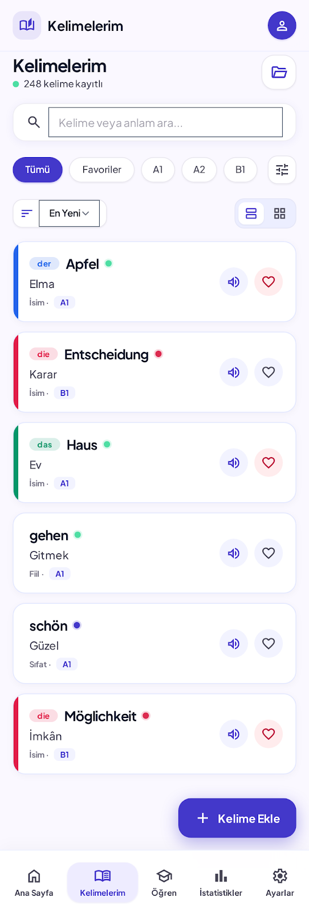
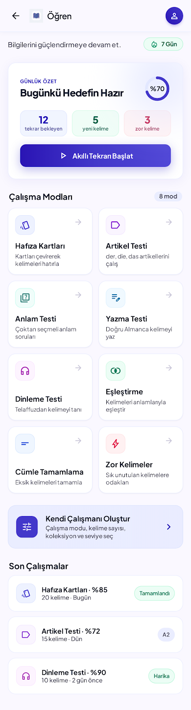
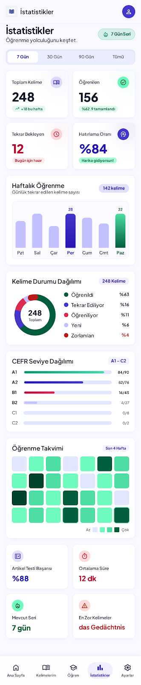

<div align="center">

# 📖 Kelime Defterim

**Almancayı kelime kelime değil, dilbilgisiyle birlikte öğren.**
Kişisel sözlüğünü kur, aralıklı tekrar ile pekiştir, ilerlemeni grafikte gör — hepsi cihazında, internet bağlantısı olmadan.

[](https://capacitorjs.com)
[](https://react.dev)
[](https://www.typescriptlang.org)
[](https://vitejs.dev)
[](#-veri-yedekleme-ve-gizlilik)
[](#-çoklu-dil)

`tek kullanıcı · sunucu yok · hesap yok · verin cihazda kalır`

</div>

---

## İçindekiler

- [Nedir?](#-nedir)
- [Ekranlar](#-ekranlar)
- [Almanca dil modeli](#-almanca-dil-modeli)
- [Kelime yönetimi](#-kelime-yönetimi)
- [Öğrenme modları](#-öğrenme-modları)
- [Tekrar motoru](#-tekrar-motoru-spaced-repetition)
- [İstatistik ve hedefler](#-istatistik-ve-hedefler)
- [Bildirimler](#-bildirimler)
- [Tema ve görünüm](#-tema-ve-görünüm)
- [Çoklu dil](#-çoklu-dil)
- [Veri, yedekleme ve gizlilik](#-veri-yedekleme-ve-gizlilik)
- [Mimari](#-mimari)
- [Teknoloji](#-teknoloji)
- [Kurulum ve Android derlemesi](#-kurulum-ve-android-derlemesi)
- [Durum: ne tamamlandı, ne eksik](#-durum-ne-tamamlandı-ne-eksik)
- [Yol haritası](#-yol-haritası)

---

## ✨ Nedir?

Kelime Defterim, Almanca öğrenen biri için tasarlanmış kişisel bir Android kelime platformudur. Basit bir "kelime → çeviri" listesinden farkı, Almancanın gerçekten dilbilgisini taşıması: isimler artikel ve çoğul biçimiyle, fiiller çekim ve yardımcı fiiliyle, sıfatlar komparativ/superlativ dereceleriyle, edatlar hangi hâli (Kasus) gerektirdiğiyle kaydedilir.

Uygulama tek kullanıcı içindir: kayıt ekranı, bulut hesabı veya sunucu sorgusu yoktur. Tüm veri cihazda kalır, hiçbir içerik üçüncü taraf bir servise gönderilmez. Seslendirme cihazın kendi ses motorundan gelir; ağ yalnızca Google Fonts yazı tipi indirilirken kullanılır ve bağlantı yoksa sistem yazı tipine düşülür.

| | |
|---|---|
| 🗂 **36 örnek kelime + 5 koleksiyon** içeren hazır başlangıç verisi | 4 adımlı onboarding'de tek dokunuşla yüklenir, tek dokunuşla temizlenir |
| 🧠 **8 öğrenme modu** + aralıklı tekrar motoru | Kart, artikel, anlam, yazma, dinleme, eşleştirme, cümle, zor kelimeler |
| 🇩🇪 **11 kelime türü** için ayrı dilbilgisi formu | Nomen, Verb, Adjektiv, Präposition ve diğerleri |
| 📊 **Gerçek veriden grafik** | Isı haritası, haftalık çubuklar, durum halkası, CEFR dağılımı |
| 🎨 **8 renk paleti**, açık/koyu/sistem teması | Artikel renkleri de kullanıcı tarafından değiştirilebilir |
| 🌍 **TR / DE / EN arayüz** | Arayüz dili ile anlam dili birbirinden bağımsız |

---

## 📱 Ekranlar

Aşağıdaki görseller projenin tasarım referansıdır (Stitch çıktıları, `TasarimGorselleri/` altında). Uygulama bu tasarımlardan Material 3 ilkeleriyle üretilmiştir.

| Ana Sayfa | Kelimelerim |
|---|---|
|  |  |
| **Öğren & Tekrar Et** | **İstatistikler** |
|  |  |

Ekran akışı: altta 5 sekme (**Ana Sayfa · Kelimelerim · Öğren · İstatistikler · Ayarlar**), üzerinde yığınlı (stack) alt sayfalar: kelime detayı, kelime editörü, koleksiyon detayı, oturum kurulumu ve çalışma oturumu. Android geri tuşu `popstate` üzerinden yığını geri sarar ([`src/app/App.tsx:71`](src/app/App.tsx#L71)).

---

## 🇩🇪 Almanca dil modeli

Kelime kaydı düz bir çeviri satırı değil, ilişkisel bir yapıdır. Bir kelimenin birden çok anlamı (Sense), her anlamın kendi bağlamı olabilir:

```ts
// die Bank → "oturak" ve "finans kurumu" aynı kayıtta, ayrı anlamlar olarak
{
  german: 'Bank', article: 'die', type: 'noun', level: 'A2',
  senses: [
    { tr: 'Bank, oturak', en: 'bench' },
    { tr: 'Banka (finans kurumu)', en: 'bank (financial institution)', context: 'Finans' },
  ],
  noun: { plural: 'die Bänke' },
  examples: [
    { de: 'Wir sitzen auf der Bank.', tr: 'Bankta oturuyoruz.' },
    { de: 'Ich gehe zur Bank.',      tr: 'Bankaya gidiyorum.' },
  ],
}
```

Kelime türü seçildiğinde editörde **o türe özgü dinamik form** açılır ([`src/core/types.ts`](src/core/types.ts)):

| Tür | Alanlar |
|---|---|
| **Nomen** | artikel (`der/die/das`), çoğul, Genitiv Singular, `nur Plural`, `ohne Plural`, N-Deklination |
| **Verb** | 3. tekil şimdiki zaman, Präteritum, Partizip II, yardımcı fiil (`haben`/`sein`), düzensiz, ayrılabilir, dönüşlü, modal, gerektirdiği edat + Kasus |
| **Adjektiv** | Komparativ, Superlativ |
| **Präposition** | gerektirdiği hâller (Akk/Dat/Gen), Wechselpräposition işareti |
| **Diğer** | Adverb, Pronomen, Konjunktion, Numerale, Interjektion, Redewendung/Feste Wendung, Sonstige |

Yazım kuralları: metinler Unicode **NFC** olarak normalize edilir, arama `ä→a`, `ö→o`, `ü→u`, `ß→ss` katlamasıyla `Mädchen`, `maedchen` ve `madchen` girdilerinin hepsinde sonuç verir; alfabetik sıralama `de` locale'i ile yapılır. Artikel yalnızca renk değildir — metni her zaman görünür, renk sadece vurgudur ve erişilebilirlik için renk dışı kodlama korunur.

---

## 🗂 Kelime yönetimi

**Kelimelerim** ekranı kişisel sözlüğünün kontrol merkezidir.

- 🔍 **Arama**: kelime, her anlam (TR/EN), etiket ve örnek cümlede.
- 🎯 **Filtreler**: favori, CEFR seviyesi, kelime türü, artikel, öğrenme durumu, koleksiyon — hepsi birlikte kullanılabilir.
- ↕️ **Sıralama**: en yeni, en eski, alfabetik, en çok tekrar, en çok hata, vakti gelenler.
- ✅ **Çoklu seçim**: toplu silme, koleksiyona atama, favori, tekrar listesine ekleme.
- ↩️ **Geri alma**: silme sonrası `undoBuffer` üzerinden kelime + tekrar geçmişi + koleksiyon bağları geri yüklenir.
- ✏️ **İki ekleme modu**: *Hızlı ekleme* (yalnızca kelime, tür ve bir anlam yeter) ve *Detaylı ekleme* (10 bölüm). Bilinmeyen artikel `Bilinmiyor` olarak kaydedilebilir; eksik alan yüzünden kayıt engellenmez.
- 🛡 **Düzenleme güvenliği**: kelimeyi düzenlemek tekrar geçmişini silmez; aynı kelime tekrar eklenirse uyarı verilir ama farklı dil/tür/anlam yanlışlıkla engellenmez.

---

## 🎓 Öğrenme modları

| Mod | Ne yapılır | Uygun kelime havuzu |
|---|---|---|
| `flashcard` | Kartı çevir, öz-değerlendir: *Tekrar · Zorlandım · Bildim · Çok kolay* | Tümü |
| `article` | Kelime gösterilir, `der / die / das` seçilir | Artikelli isimler (`nur Plural` hariç) |
| `meaning` | Kelimeye 4 anlamlı çoktan seçmeli soru | En az bir TR anlamı olanlar |
| `writing` | Anlamdan Almanca kelimeyi yaz, yazım denetimi | Tümü |
| `listening` | Kelime seslendirilir, sen yazarsın/seçersin | Tümü |
| `matching` | Kelime–anlam eşleştirme | Tümü |
| `sentence` | Örnek cümledeki boşluğu/çekimi tamamla | Örneğinde kelimesi geçenler |
| `hard` | Sürekli unutulan kelimeler üzerinde ekstra çalışma | `isStruggling()` eşleşenler |

**Oturum kurulumu** ([`SessionSetupScreen.tsx`](src/features/learning/SessionSetupScreen.tsx)): mod, kelime sayısı, kaynak (tümü / vakti gelenler / yeni / favoriler), koleksiyon ve seviye seçilir; havuz boşsa modun neden uygun olmadığını anlatan boş durum ekranı gösterilir. Oturum bitişinde çalışılan kelimeler, doğru/yanlış, zorlanılanlar ve tamamlanma oranı raporlanır.

✍️ Yazma testinde tolerans ayarı üç seviyedir: `strict`, `case` (büyük/küçük harf affedilir), `umlaut` (umlautlar affedilir). Almancada büyük/küçük harfin anlam taşıyabildiği varsayımıyla varsayılan `case`'dir.

🔊 **Telaffuz**: native tarafta `@capacitor-community/text-to-speech` ile `de-DE` sesi, web'de `SpeechSynthesis` yedeği kullanılır; Almanca ses paketi yoksa kullanıcıya anlaşılır uyarı gösterilir, sessiz başarısızlık yapılmaz ([`src/core/audio.ts`](src/core/audio.ts)). Ses hızı ayarlardan değiştirilebilir; doğru/yanlış/kart sesi Web Audio ile üretilir (dosya yok, boyut yok).

---

## 🧠 Tekrar motoru (Spaced Repetition)

Algoritma bileşenlerden bağımsız, saf bir servistir: [`src/core/srs.ts`](src/core/srs.ts). SM-2 ailesinden, dört yanıta göre çalışan bir zamanlayıcı:

| Yanıt | Etki |
|---|---|
| **Tekrar (0)** | `ease −0.2`, aralık sıfırlanır, `lapses +1`, 10 dakika sonra tekrar, durum → `relearning` |
| **Zorlandım (1)** | `ease −0.15`, ilk seans yarım gün, sonra `aralık × 1.2` |
| **Bildim (2)** | 1. seans → 1 gün, 2. seans → 3 gün, sonrası `aralık × ease` |
| **Çok kolay (3)** | `ease + 0.15`, aralık `× ease × 1.3` |

`ease` 1.3–3.0 arasında sınırlanır, aralık 21 günü geçince kelime `learned` kabul edilir. Kelime durumları: **Yeni · Öğreniliyor · Tekrar ediliyor · Yeniden öğreniliyor · Öğrenilmiş**. Zorlanma tespiti `lapses ≥ 3` veya son 4+ denemede doğruluk <%50 üzerinden yapılır.

Her yanıt `reviewLogs` içine kelime, zaman, mod, puan ve doğruluk olarak yazılır; bu günlükler hem istatistiklerin hem serinin (streak) gerçek kaynağıdır. Sonraki tekrar zamanı kalıcıdır — uygulama kapansa da sıfırlanmaz. Aynı kelimenin artikeli bilinip anlamı bilinmediği için her mod kendi başına sorulur.

---

## 📊 İstatistik ve hedefler

Rakamlar mock değildir, `words` + `reviewLogs` + `sessions` üzerinden hesaplanır ([`src/core/selectors.ts`](src/core/selectors.ts)).

- **Bugün**: günlük hedef halkası (tamamlanan / `dailyGoal`), vakti gelen ve gecikmiş tekrar sayısı.
- **Seri**: pazartesi başlangıçlı haftalık çubuklar + 4 haftalık **ısı haritası** (`heatCells`).
- **Dağılım**: durum halkası (öğrenildi / tekrar / öğreniliyor / yeni / zorlanılan) ve CEFR seviye dağılımı.
- **Başarı**: genel hatırlama oranı, artikel doğruluğu, en çok hata yapılan kelimeler.
- **Hacim**: toplam kelime, bu hafta eklenen, oturum süreleri ve doğru/yanlış kırılımları.

---

## 🔔 Bildirimler

Ayarlar → Bildirimler bölümünden açılır. Aralık **1 · 5 · 10 · 15 · 30 · 45 · 60 dakika · 2 · 3 · 6 saat** seçeneklerinden biridir; ayrıca **gün içinde sabit saatler** (en fazla 6 adet, `HH:MM`) ve **sessiz saatler** (başlangıç/bitiş) tanımlanabilir. Uygulama açıldığında tek seferlik hatırlatma gösterme seçeneği de vardır. İçerik üç moddan biri olur:

1. **Yalnızca kelime** → `die Möglichkeit`
2. **Kelime + anlam** → gövdeye ilk örnek cümle de eklenir
3. **Mini soru** → `___ Möglichkeit · der / die / das?`

Android'de `@capacitor/local-notifications` ile sistem planlayıcısına yazılır: kendi kanalımız (`Kelime Defterim`, önem 4, titreşim + LED), izin ihtiyaç anında istenir, ayar değişince bekleyen tüm planlar temizlenip yeniden kurulur. Kesin alarm izni verilmezse sistem **inexact** zamanlamaya düşer ve bildirim yine gelir. Web derlemesinde `setInterval` + Notification API kullanılır.

Bildirim metni arayüz ve anlam dili ayarlarına uyar; "Test bildirimi gönder" gerçek bir bildirim gönderir, izin reddedilirse uygulama çalışmaya devam eder ([`src/features/notifications/service.ts`](src/features/notifications/service.ts)).

> ⚠️ **Dürüst sınır**: Android tarafında bildirimler uygulama arka plandayken veya kapalıyken de planlanır — ancak Android hiçbir zamanlayıcı API'sine "dakkası dakkasına" garanti vermez (Doze, pil tasarrufu, üretici kısıtlamaları). Bu yüzden seçtiğin aralık saklanır, kesinlik vaat edilmez. Web derlemesinde ise bildirim yalnızca sekme açıkken çalışır.

---

## 🎨 Tema ve görünüm

- **Tema**: Açık / Koyu / Sistem ( `prefers-color-scheme` dinlenir, değişim anında yansır).
- **8 renk paleti**: Ultramarine · Adaçayı yeşili · Sıcak turuncu · Okyanus mavisi · Lavanta · Toprak · Bordo · Minimal gri.
- **Artikel renkleri**: `der` mavi, `die` kırmızı, `das` yeşil — kullanıcı her üçünü ayrı ayrı değiştirebilir.
- **Görünüm tercihleri**: yazı ölçeği, kart yoğunluğu (rahat/kompakt), animasyon azaltma.
- Renkler CSS token'ları ile merkezden yönetilir (`data-theme`, `data-palette`, `data-density`, `--fs`, `--der/--die/--das`); bileşen içinde sabit renk yoktur. Neon, aşırı gradyan ve gereksiz gölge yerine temiz yüzey + belirgin kart disiplini ([`src/theme/app.css`](src/theme/app.css)).

---

## 🌍 Çoklu dil

Arayüz **TR / DE / EN**; kelime anlamları **TR / EN** tutulabilir. Bu üç ayar bilinçli olarak birbirinden bağımsızdır:

```
Arayüz: Türkçe  ·  Öğrenilen dil: Almanca  ·  Anlam: Türkçe
Arayüz: Almanca ·  Öğrenilen dil: Almanca  ·  Anlam: İngilizce
```

Dil değiştirmek hiçbir kelime verisini silmez. Tüm görünen metinler `t('anahtar')` ile modüler sözlüklerden gelir; JSX içinde sabit Türkçe metin yoktur ([`src/localization/`](src/localization/index.ts)). Eksik anahtar Türkçeye düşer, interpolate (`{{n}}`) desteklenir, tarih biçimi locale'e göre kurulur.

---

## 💾 Veri, yedekleme ve gizlilik

**Depolama**: Zustand + `persist` middleware ile `localStorage` anahtarı `kelime-defterim-v1`. Kelimeler, koleksiyonlar, tekrar günlükleri, oturumlar ve ayarlar tek kalıcı kayıtta tutulur. Eski bir kayıttan yüklenirken eksik kalan tercihler `defaultSettings` ile doldurulur; yani yeni sürümde eklenen bir ayar, eski kullanıcının verisini bozmaz ([`src/core/store.ts`](src/core/store.ts)).

| İşlem | Format | Not |
|---|---|---|
| Tam yedek al | **JSON** (`version: 1`) | Kelimeler, anlamlar, örnekler, koleksiyonlar, tekrar geçmişi, oturumlar, ayarlar |
| Yedekten dön | **JSON** | `app` + `version: 1` + kelime dizisi doğrulanır, **önizleme** (kelime/koleksiyon/tekrar kaydı sayısı) + **birleştir / değiştir** seçimi, hata durumunda mevcut veri korunur |
| Veri durumu | **Bilgi ekranı** | Ayarlar → Kelime, koleksiyon, tekrar ve oturum sayıları ile depolama türü |
| Kelime listesi | **CSV** dışa aktarma | `;` ayırıcı + BOM (Excel TR/DE uyumu), anlamlar ve örnekler `|` ile birleştirilir |

Gizlilik: veri cihazda kalır, üçüncü taraf sunucuya otomatik gönderim yok, kaynak koduna gömülü token/anahtar yok, SQL yerine bellek içi durum olduğu için injection yüzeyi yok. Dışa aktarılan dosyalar indirilen adla kullanıcıya aittir.

---

## 🏗 Mimari

Feature-first + katmanlı yapı. Tek dosyalı yaklaşım yok: ekranlar JSX, iş mantığı `core`, veri dönüşümü `features/*/` ve ortak arayüz `shared/` katmanında durur.

```text
src/
├── app/            App.tsx (tema + gezinme kabuğu) · navigation.ts (stack + sekmeler)
├── core/           types.ts · store.ts (zustand + persist) · srs.ts · selectors.ts · audio.ts · seed.ts
├── features/
│   ├── home/ vocabulary/ collections/ learning/ statistics/ settings/
│   ├── notifications/ backup/ onboarding/
├── shared/         ui.tsx (TopBar, Stepper, EmptyState, ProgressRing, Toast…) · toastStore.ts
├── theme/          app.css — token, tema, palet, animasyon
└── localization/   tr.ts · de.ts · en.ts · index.ts (t, useMeaning, formatLocaleDate)
```

Kurallar: ekranlarda doğrudan veri yazma yok (her mutasyon `store` aksiyonu üzerinden), tekrar algoritması React'ten bağımsız saf fonksiyon, ortak bileşenler `shared/ui.tsx`'te, dairesel bağımlılık yok, `strict` TypeScript'te tip kaçışı yok.

**Kod ölçeği**: 29 kaynak dosya / ~6.170 satır TS+TSX+CSS. Üretim derlemesi ~369 kB JS (gzip ~107 kB) + 49 kB CSS.

---

## ⚙️ Teknoloji

| Katman | Seçim |
|---|---|
| Kabuk | React 18 + TypeScript 5.6 (`strict`) + Vite 6 |
| Durum & kalıcılık | Zustand 5 + `persist` (localStorage) |
| Native köprü | Capacitor 7 (`@capacitor/android`), `androidScheme: https`, appId `com.kelimedefterim.app` |
| Bildirimler | `@capacitor/local-notifications` 7 (Android planlama) + Notification API (web) |
| Seslendirme | `@capacitor-community/text-to-speech` + Web SpeechSynthesis yedeği |
| İkonlar | lucide-react |
| İstatistik | SVG + CSS ile elle çizilmiş halka/çubuk/ısı haritası (grafik kütüphanesi yok) |
| Yazı tipi | Plus Jakarta Sans (Google Fonts, çevrimdışıyken sistem yedeğine düşer) |

---

## 🚀 Kurulum ve Android derlemesi

```bash
# 1. Bağımlılıklar
npm install

# 2. Tarayıcıda geliştirme
npm run dev

# 3. Tip kontrolü + üretim derlemesi
npm run build

# 4. Web derlemesini Android projesine kopyala
npx cap sync android

# 5. APK
cd android && gradlew assembleDebug
# çıktı: android/app/build/outputs/apk/debug/app-debug.apk

# Android Studio ile çalıştırmak için
npx cap open android
```

Gereksinimler: Node 18+, JDK 17+, Android SDK 35 (`compileSdk`/`targetSdk` 35, `minSdk` 23). `android/` klasörü Capacitor tarafından üretilmiş ve depoya eklenmiştir; `npx cap sync` web asset'lerini ve plugin kayıtlarını yeniler.

---

## 🧭 Durum: ne tamamlandı, ne eksik

Gereksinim dokümanında (`KELİME DEFTERİM — PROFESYONEL ANDROID UYGULAMASI GELİŞTİRME TALİMATI`) tanımlı kapsama göre dürüst durum:

| Konu | Durum |
|---|---|
| Kelime modeli, artikel, fiil/sıfat/edat formları, çoklu anlam | ✅ Tamam |
| Kelime listesi, arama, filtre, sıralama, çoklu seçim, geri alma | ✅ Tamam |
| Hızlı + detaylı ekleme, düzenlemede geçmişin korunması | ✅ Tamam |
| 8 öğrenme modu, oturum kurulumu ve sonuç raporu | ✅ Tamam |
| Aralıklı tekrar motoru, kalıcı tekrar zamanları, zor kelime tespiti | ✅ Tamam |
| İstatistikler, hedefler, seri, ısı haritası | ✅ Tamam |
| TR/DE/EN arayüz, arayüz–anlam dili ayrımı | ✅ Tamam |
| Tema, 8 palet, artikel renkleri, yazı ölçeği, yoğunluk | ✅ Tamam |
| Telaffuz (native + web) ve hız ayarı | ✅ Tamam |
| JSON tam yedek / geri yükleme, CSV dışa aktarma | ✅ Tamam |
| Onboarding + örnek veri | ✅ Tamam |
| Bildirimler | ✅ Native planlama: aralık + sabit saatler + sessiz saatler + açılış bildirimi (web'de yalnızca sekme açıkken) |
| CSV içe aktarma | 🟡 Dışa aktarma var, içe aktarma yok |
| SQLite veritabanı + migration | ❌ Yerine localStorage kullanılıyor |
| Android ana ekran widget'ları | ❌ Yok |
| GitHub Releases üzerinden APK güncelleme | ❌ Yok |
| Firebase-free yapı, hesap/ giriş ekranı olmaması | ✅ Gereksinime uygun |
| Otomatik kelime önerisi (sözlük/AI servisi) | ❌ Yalnızca manuel giriş |
| Birim/entegrasyon testleri, CI/CD, imzalı release | ❌ Yok |

---

## 🗺 Yol haritası

1. **SQLite katmanı** — mevcut `store` aksiyon arayüzü korunarak veri erişimi repository'ye taşınır, `schema_migrations` ile güncellemelerde veri korunur.
2. **Zamanlama doğrulaması** — gerçek cihaz matrisinde Doze/pil tasarrufu altında gecikme ölçümü; gerekiyorsa `WorkManager` tabanlı planlamaya geçiş ve yeniden başlatma sonrası plan onarımı.
3. **Ana ekran widget'ları** — Kotlin `AppWidgetProvider` + günün kelimesi / hedef / tekrar widget'ları, ayarlar `widgetId` bazında.
4. **GitHub updater** — Release kontrolü, SHA-256 doğrulaması, `PackageInstaller` akışı ve GitHub Actions ile imzalı APK yayını.
5. **Test altyapısı** — `srs.ts`, `selectors.ts`, `foldForSearch`, sürüm/yedek doğrulama birim testleri; Vitest + Android native testler.
6. **CSV içe aktarma** ve otomatik öneri sağlayıcısı için takılabilir arayüz.

---

## 🤝 Katkı

Her bağımsız iş tek commit olsun; conventional commit kullanılıyor (`feat:`, `fix:`, `test:`, `docs:`). Bir özelliği "bitti" saymadan önce UI, veri kalıcılığı, uygulamayı kapatıp açtıktan sonra verinin durması ve hata senaryoları kontrol edilmeli.

Değişiklik öncesi `npm run build` (tip kontrolü dahil) temiz geçmeli.

---

## 📄 Lisans ve kaynaklar

Bu depoda henüz bir `LICENSE` dosyası yoktur. Tasarım referansları `TasarimGorselleri/` içinde, uygulama ekran eşleşmeleri `src/features/` altında. Sorun ve öneriler için depo issue'larını kullanabilirsin.
